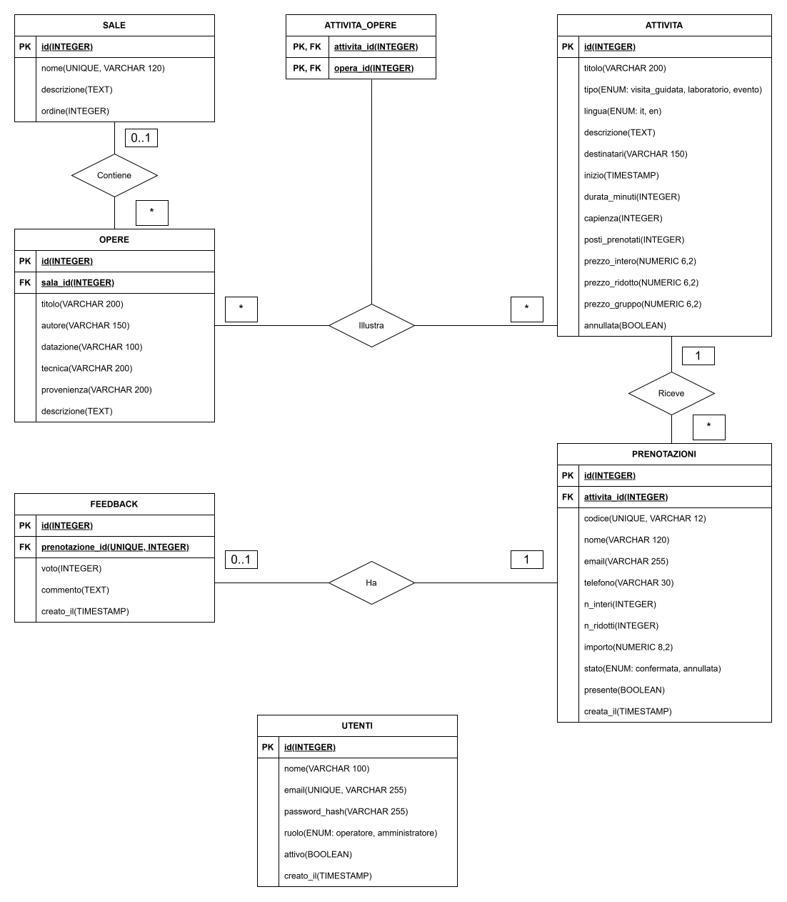

# Modello dei dati

## Diagramma entità-relazione

Il diagramma è stato realizzato con draw.io ed è modificabile: [apri in draw.io](https://app.diagrams.net/#Uhttps%3A%2F%2Fraw.githubusercontent.com%2FForklein%2Fpiattaforma-museo-diocesano-monopoli%2Fmain%2Fdocs%2Fdiagrammi%2Fmodello-dati.drawio.svg).

Nel diagramma le tabelle sono indicate con i nomi usati nel database (SALE, OPERE, ATTIVITA, ATTIVITA_OPERE, PRENOTAZIONI, FEEDBACK, UTENTI). Il numero accanto a ogni tabella indica quante righe di quella tabella partecipano alla relazione: 1 = esattamente una, 0..1 = al massimo una, * = zero o più.

## Le entità

- **Sala**: le sale del percorso espositivo. Il campo `ordine` indica la posizione della sala lungo la visita.
- **Opera**: le schede del catalogo. Ogni opera può essere collocata in una sala.
- **Attività**: visite guidate, laboratori ed eventi, con data di inizio, durata, capienza e tariffe. Il tipo può essere `visita_guidata`, `laboratorio` o `evento`; la lingua `it` o `en`.
- **Attività_opere**: tabella di collegamento che indica quali opere vengono illustrate in quale attività.
- **Prenotazione**: i dati del visitatore, il numero di biglietti, l'importo, lo stato (`confermata` o `annullata`) e la presenza.
- **Feedback**: il voto da 1 a 5 e il commento facoltativo lasciati dopo l'attività.
- **Utente**: gli account del personale del museo, con ruolo `operatore` o `amministratore`.

## Le relazioni

| Relazione | Cardinalità | Significato |
|---|---|---|
| Sala - Opera | uno a molti | Una sala contiene più opere; un'opera può anche non avere una sala assegnata |
| Attività - Opera | molti a molti | Un'attività illustra più opere e la stessa opera compare in più attività; per questo serve la tabella di collegamento |
| Attività - Prenotazione | uno a molti | Un'attività riceve più prenotazioni; ogni prenotazione riguarda una sola attività |
| Prenotazione - Feedback | uno a uno (facoltativo) | Ogni prenotazione può avere al massimo un feedback |

La tabella Utente non è collegata alle altre: gli account servono solo per accedere all'area riservata.

Quando si elimina un dato collegato ad altri, il database si comporta così:
- se si elimina una sala, le sue opere restano nel catalogo senza sala;
- un'attività che ha prenotazioni non si può eliminare: si annulla, così lo storico resta disponibile per le statistiche;
- se si elimina una prenotazione, viene eliminato anche il suo feedback;

## Vincoli di integrità

Oltre ai controlli nel codice, alcune regole sono garantite direttamente dal database, così restano valide anche in caso di errori nell'applicazione:

- la capienza deve essere maggiore di zero;
- i posti prenotati devono essere compresi tra zero e la capienza;
- ogni prenotazione deve avere almeno un biglietto e nessun numero negativo;
- il voto del feedback deve essere compreso tra 1 e 5;
- il codice di prenotazione e l'email degli utenti devono essere unici;
- per ogni prenotazione può esistere un solo feedback;
- i campi tipo, lingua, stato e ruolo accettano solo i valori previsti (per esempio `visita_guidata`, `laboratorio` o `evento` per il tipo di attività);

## Scelte di progettazione

**Il contatore dei posti prenotati.** Il numero di posti occupati si potrebbe calcolare ogni volta sommando le prenotazioni confermate. Ho scelto invece di memorizzarlo nella tabella delle attività, perché in questo modo la prenotazione può controllare e aggiornare i posti con un'unica istruzione atomica su una sola riga, che è la base per gestire correttamente le richieste simultanee. È una ridondanza controllata: il vincolo sul database impedisce che il contatore superi la capienza.

**I visitatori non hanno una tabella propria.** Come stabilito nell'analisi dei requisiti, i visitatori non si registrano: i loro dati sono salvati nella prenotazione. Se la stessa persona prenota più volte, i suoi dati vengono ripetuti; è un compromesso accettato in cambio di una prenotazione più semplice e di meno dati personali conservati.

**L'importo viene salvato nella prenotazione.** Non è una ridondanza: le tariffe di un'attività potrebbero cambiare dopo la prenotazione, mentre l'importo deve restare quello calcolato al momento della prenotazione.

**Le prenotazioni annullate non vengono cancellate.** Cambiano stato, così restano disponibili per le statistiche e lo storico. Allo stesso modo le attività vengono annullate, non eliminate.

**I campi con valori prestabiliti.** Tipo e lingua delle attività, stato delle prenotazioni e ruolo degli utenti possono assumere solo pochi valori fissi. Nel diagramma sono indicati come ENUM, ma nel database sono salvati come testo con un vincolo CHECK che accetta solo i valori previsti, perché SQLite non ha un tipo ENUM: in questo modo lo schema è identico in SQLite e in PostgreSQL. Ho scelto di non creare tabelle separate per questi valori perché sono pochi e stabili, e nel caso dei ruoli il comportamento dell'applicazione dipende direttamente dal valore.

**La presenza ha tre stati.** Il campo `presente` può valere vuoto (presenza non ancora registrata), vero (presente) o falso (assente). Distinguere "non registrata" da "assente" serve per calcolare correttamente il tasso di assenze.

**I prezzi sono numeri decimali esatti.** Importi e tariffe usano il tipo decimale e non i numeri in virgola mobile, che in binario non possono rappresentare esattamente valori come 0,10 e introdurrebbero piccoli errori nei calcoli.

**Le date sono salvate in UTC.** Tutte le date e gli orari sono memorizzati nel fuso orario universale e convertiti in ora italiana solo quando vengono mostrati. In questo modo i calcoli restano corretti anche nei passaggi tra ora legale e ora solare.

**Gli indici.** Oltre alle chiavi primarie, sono indicizzati i campi usati più spesso nelle ricerche: la data di inizio e il tipo delle attività, l'attività di ogni prenotazione, il codice di prenotazione, l'email degli utenti e la sala delle opere.